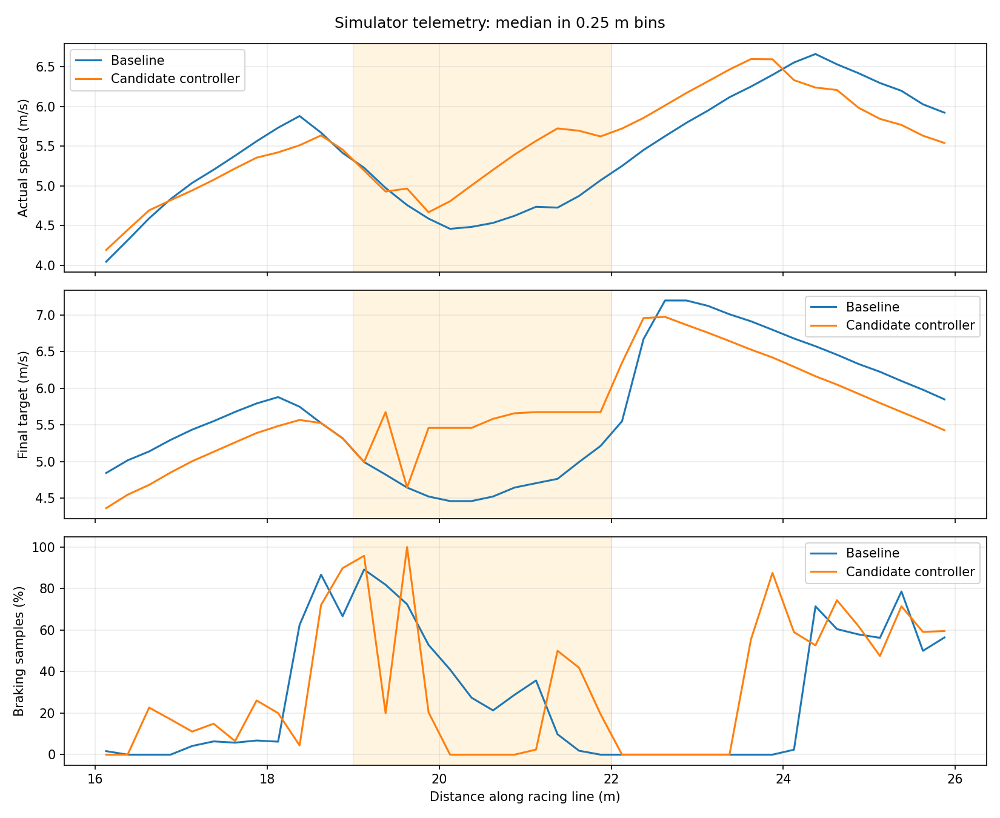

# Corner-exit investigation, 16 October 2026

This records the earlier Windows corner-exit work. The later Linux/Windows
latency correction and current selected defaults are documented in
`headless-pace-2026-10-16.md`; the same actor and safety limits are retained.

**Current selection:** 18 m/s^2 planning lateral allowance, guarded exit
preview enabled, original throttle controller, and the existing v2 actor.
Two full simulator runs completed all 20 timed laps with zero collisions.

## Accepted results

| Configuration / run | Best lap | Ten-lap total | Maximum steady cross-track error | RTF |
| --- | ---: | ---: | ---: | ---: |
| Original, baseline A | 11.0879 s | 112.8843 s | .397 m | .640 |
| Original, baseline B | 11.0208 s | 111.8620 s | .422 m | .458 |
| Selected 18 profile, explicit parameters | 11.0708 s | 111.0617 s | .254 m | .666 |
| Selected 18 profile, actual defaults | 11.0588 s | 111.2049 s | .274 m | .670 |

Mean race total improved from 112.3732 to 111.1333 s: 1.2399 s (1.10%).
The best single lap did not improve (.0380 s slower than the best reference).
No faster lap from a rejected experiment is used to claim success.

| Exit metric, arc 19-22 m | Two baselines | Two accepted runs |
| --- | ---: | ---: |
| Median measured speed | 4.689-4.696 m/s | 5.095-5.156 m/s |
| Minimum measured speed | 4.167-4.258 m/s | 4.433-4.459 m/s |
| 95th-percentile cross-track error | .1028-.1034 m | .1022 m |
| Throttle jumps > .5 per 1,000 adjacent samples | 195.5-213.8 | 107.7-111.7 |
| 95th-percentile throttle step magnitude | .785-.800 | 1.020-1.025 |

Exit speed and average pace improved, and large throttle jumps occurred less
often. Individual command jumps remain large: this is a partial smoothness
improvement, not elimination of torque switching or measured physical jerk.
The taper experiments did not establish a better pace/tracking combination.



Both baselines and both accepted runs had zero occupied/unknown samples in
the static-map disk proxy at the known .135 m half-width. The .215 m disk,
which includes the .08 m margin, flagged samples at arcs 29-30 in all four
runs (35/10,384 and 62/11,148 baseline; 101/10,047 and 101/10,062 accepted).
These point-sampled disks are proximity diagnostics, not a full oriented
vehicle-footprint or track-boundary proof.

The accepted result files are
`results/submitted/OG7__cornerexit_preview18_20261016_a.json` and
`results/submitted/OG7__cornerexit_default_20261016_b.json`. Copies were checked
byte-for-byte against the unedited referee originals. The default run supplied
only `trace_path`; ROS parameter readback confirmed lateral allowance 18,
top speed 7.2, preview enabled, curvature guard .30, original throttle band 0,
and `residual_policy_v2_sub12_candidate.npz`.

## Root cause from fresh simulator telemetry

The reported exit matches the wall-adjacent bend around racing-line arc 19-22 m
in the earlier project diagnostics. No new video was attached in this session.
Arc coordinates are used for analysis only; no driving decision is gated on
track coordinates.

The fresh baseline trace at arc 20.31 m recorded:

| Quantity | Value |
| --- | ---: |
| Measured speed | 4.2584 m/s |
| Curvature-profile target | 6.6991 m/s |
| Actor target | 6.8820 m/s |
| Final target after safety | 4.3313 m/s |
| Constant-steering path clearance | 3.6 m |
| Route curvature now / 1 m ahead | -0.1338 / -0.0161 per m |
| Lookahead | 1.5 m |

The safety projection holds the proposed steering angle for its entire arc.
That arc reaches the wall even though the followed path is straightening. Its
stopping cap is `sqrt(2 * 2.8 * (3.6 - 0.25)) = 4.3313 m/s`. Measured speed
then follows this reduced target. The path profile, instantaneous steering
curvature cap, and actor were permitting more speed at this location.

The existing speed profile already interpolates a closed-track curvature plan
with forward acceleration, backward braking, and a friction ellipse. Pure
pursuit uses a speed-adaptive lookahead, capped at 1.5 m in this configuration.
Those mechanisms and the 7.2 m/s ceiling are retained.

Simply relaxing the safety arc was insufficient. The old 24 m/s^2 lateral
allowance let the profile request about 3.98 m/s at arc 35, while the actual
baseline hairpin speed was near 2 m/s under reactive LiDAR braking. The 24
preview repeat developed larger tracking excursions at this hairpin. The 18
setting requests about 3.45 m/s there and uses the existing backward pass to
begin braking earlier. It produced the accepted race/linekeeping improvement.
This is an empirically selected planning allowance, not a claim that the
physical grip limit has been measured at 18 m/s^2.

A three-lap 15 m/s^2 pilot improved tracking but was slower (34.2390 s total).
The matched 18 pilot took 33.3116 s versus the 33.6167 s baseline pilot,
before the two full-format validations. Pilots are diagnostic only and were
not copied into `results/submitted/`.

Pose diagnostics also found 73/4,964 baseline samples using an IPS position
different from the latest odometry position by over 1 mm, including 31 over
5 cm (maximum 8.75 cm). These occurred mostly on straights; they do not
establish the cause of the hairpin excursions. Pose-selection behavior was
left unchanged. Actual odometry yaw rate is now available in traces.

## Rejected experiment and guard

An existing optional follower preview was disabled in the running default.
Enabling it without an additional curvature guard caused a DNF_STUCK after
five timed laps, with zero recorded collisions. It must not be selected on
the basis of its individual unscored lap times.

The trace shows preview activation at another exit with route curvature about
0.89 per m and commanded curvature about 0.65 per m. The car accelerated and
developed a large heading error, eventually stopping against a zero safety
target. The geometric preview does not model grip or yaw transients.

The preview now refuses to lift the speed cap when either current route
curvature or commanded steering curvature exceeds 0.30 per m. Existing pose
alignment, easing-curvature, upcoming-braking, map-footprint, LiDAR-validity,
and obstacle checks remain active. It holds the actual steering briefly before
predicting the existing follower. The finite preview endpoint and at most
1.0 m/s lift over the original cap remain in force.

Tests cover tight exits, large steering corrections, upcoming braking,
parallel and crossing walls, invalid scans, unknown/occupied map cells, and
the real ROS driver integration. The optional positive-torque taper preserves
negative braking commands; only positive torque near the target is tapered.

## Earlier 24 m/s^2 experiments (not selected)

All runs use the unchanged referee, two unscored laps (out lap plus one warm-up
lap), ten timed laps, the same packaged actor, and the connected native
AutoDRIVE simulator. Each run records its exact parameters and source/asset
hashes in `results/corner_exit_20261016/`.

| Run | Status | Best lap | Ten-lap total | Collisions | RTF |
| --- | --- | ---: | ---: | ---: | ---: |
| `cornerexit_baseline_20261016_a` | COMPLETE, scored | 11.0879 s | 112.8843 s | 0 | .640 |
| `cornerexit_preview_20261016_a` (no curvature guard) | DNF_STUCK, unscored | - | - | 0 | .698 |
| `cornerexit_preview_20261016_b` (with guard) | COMPLETE, scored | 10.9478 s | 111.3126 s | 0 | .507 |
| `cornerexit_smooth_preview_20261016_a` (guard + .15 m/s taper) | COMPLETE, scored | 11.0508 s | 112.4000 s | 0 | .608 |
| `cornerexit_baseline_20261016_b` | COMPLETE, scored | 11.0208 s | 111.8620 s | 0 | .458 |
| `cornerexit_smooth_preview_20261016_b` (gradual lift + taper) | COMPLETE, scored | 11.0598 s | 113.0234 s | 0 | .663 |
| `cornerexit_preview_20261016_c` (gradual lift, original throttle) | COMPLETE, scored | 10.8808 s | 112.5472 s | 0 | .548 |
| `cornerexit_default_20261016_a` (guarded default repeat) | COMPLETE, scored | 10.8918 s | 114.9101 s | 0 | .499 |

The most promising initial controls were the guarded preview with original throttle behavior
(`speed_approach_band_mps: 0.0`). The gradual-lift experiment has been removed
from the selected implementation. Although it produced a faster single lap,
its steady maximum cross-track error reached .778 m at another hairpin,
compared with .397/.422 m in the two baselines. This is insufficient evidence
to select it as a stable improvement. Its source snapshot and result remain
in the ignored experiment directory. No causal claim that blending alone
caused this excursion is made: simulator pacing also varied.

The first guarded run's steady maximum cross-track error was .426 m and
its whole-track 95th percentile was .254 m, compared with .261/.225 m in the
two baselines. At the requested exit, the 95th-percentile error was .102 m
versus .103 m. The static-map disk check, including the existing .08 m side
margin, flagged 64/12,143 samples versus 35/10,384 and 62/11,148 in the
baselines. This is a proximity proxy, not a full vehicle-footprint or track
boundary proof. The unchanged referee recorded zero collisions.

The first guarded preview run improved the complete ten-lap comparison by 1.5717 s
(1.39%) against baseline A and .5494 s (.49%) against baseline B. Its final
default-entry repeat instead worsened to 114.9101 s and .884 m maximum
steady cross-track error. Although median exit speed increased to 5.279 m/s,
the section minimum dropped to 4.009 m/s and large target/control steps
remained. That 24 m/s^2 combination was rejected; the later accepted 18
configuration at the start of this report supersedes it.

| Earlier exit metric, arc 19-22 m | Baseline A | First 24 guarded trial |
| --- | ---: | ---: |
| Median actual speed | 4.696 m/s | 5.168 m/s |
| Minimum actual speed | 4.258 m/s | 4.489 m/s |
| Median final target | 4.643 m/s | 5.521 m/s |
| Braking samples | 36.7% | 32.7% |
| Throttle jumps > .5 per 1,000 adjacent samples | 195.5 | 94.3 |
| 95th-percentile throttle step magnitude | .800 | .944 |

Large throttle jumps became less frequent, but their amplitude was not
improved. Near-target torque switching and preview eligibility transitions
remain limitations; do not describe this as complete removal of throttle
oscillation. Both taper trials and the gradual-lift trials failed to establish
a better combination of race time and tracking than the accepted controls.

For further tuning, calibrate the longitudinal feed-forward/PI response using
actual acceleration and yaw telemetry. Keep 18 m/s^2, the .30/m preview guard,
and the 1.0 m/s lift as the tested reference; investigate a new candidate
separately before changing them. The fastest single-lap target remains open.

## Configuration and rollback

`driver.py` defaults and `config/driver_params.yaml` enable the guarded preview
with `planning_lateral_mps2: 18.0` and retain the original residual actor and
throttle controller. `fast_corner_18_residual_v2_exit_preview_params.yaml`
selects the same controls explicitly. The legacy configuration files disable the
preview so they remain reproducible rollback choices. The old `wall_exit`
configuration retains its .15 m/s taper and is not the current selection.

New tuning parameter: `safety_exit_preview_max_curvature_inv_m: 0.30`. This
limits both current route curvature and the curvature of the actual proposed
steering. Keep this guard and the 1.0 m/s gain bound until further simulator
tests justify changing them. Recalibrate grip and yaw response before allowing
the geometric predictor to lift limits in tight turns. The existing aggressive
planning lateral-acceleration override is not a dynamic stability guarantee.
Both the controller defaults and selected launch YAML are checked by an
integration test. The package rebuilt successfully and all 63 tests passed.

The final implementation changes `team_driver/exit_preview.py` (eligibility),
`team_driver/driver.py` (parameters, selected default, telemetry),
`team_driver/diagnostics.py` (trace columns), the selected/rollback YAMLs,
`test/test_exit_preview.py`, `test/test_driver_diagnostics.py`,
`test/test_diagnostics.py`, `test/test_corner_exit_analysis.py`, and
`training/analyze_corner_exit.py`. No judging or devkit files were changed.

Inside the existing ROS container, with the bridge connected and no other
driver running:

```bash
source /opt/ros/humble/setup.bash
ws=/hackathon/.worktrees/task1-residual-rl-baseline/race_ws
source "$ws/install/local_setup.bash"
ros2 run team_driver driver
```

For the original reference, pass
`--ros-args --params-file "$ws/src/team_driver/config/fast_corner_24_residual_v2_sub12_params.yaml"`.
In a clean submission clone the workspace is `/hackathon/race_ws`.

## Telemetry and analysis

`speed_mps` is actual odometry speed; `final_target_mps` is the target passed
to the speed controller. Traces also contain the profile and actor targets,
actual command curvature, route curvature now/1 m/3 m ahead, selected target
segment and point, lookahead, steering, throttle, path clearance, preview use,
the limiting stage, the reason for a negative throttle command, actual yaw
rate, the last position source, and IPS/odometry position disagreement.

Tracing is opt-in through `trace_path`. It buffers samples and writes on clean
shutdown, with no CSV writes while driving. Tests verify tracing preserves
the calculated controls. CSV files, exact parameter files, referee logs, and
provenance are in `results/corner_exit_20261016/` (ignored experiment artifacts).

From `race_ws/src/team_driver`, reproduce the spatial comparison with:

```bash
python3 -m training.analyze_corner_exit \
  /hackathon/.worktrees/task1-residual-rl-baseline/results/corner_exit_20261016 \
  cornerexit_baseline_20261016_b cornerexit_default_20261016_b --team OG7
```

This writes comparison JSON and, when matplotlib is available, a PNG. It
compares complete route passes after the first two map-origin crossings,
excluding the final partial pass. These boundaries are for steady telemetry
analysis, not referee lap scoring. Throttle variation is a command-smoothness
measure; no physical jerk measurement is claimed. Simulator pacing differs
between runs and can affect the existing wall-timed PI controller.
