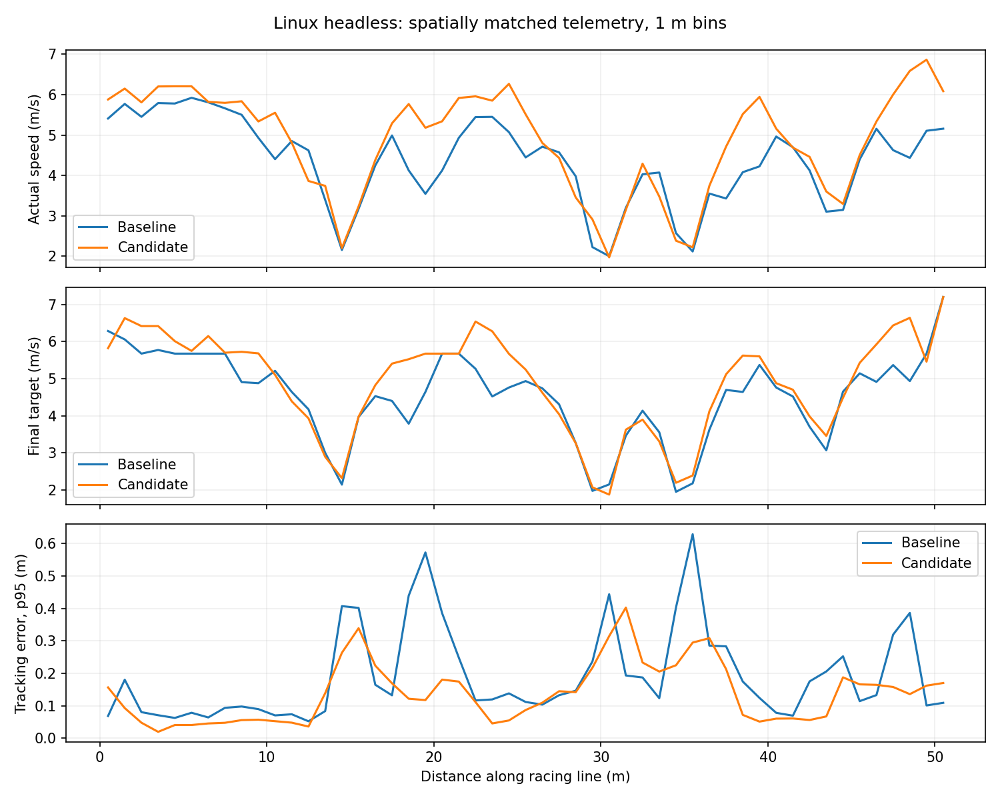

# Linux headless pace correction, 16 October 2026

## Result and selected version

The original submitted actor was correct. GitHub checked out PR merge commit
`13ffab66f85dddb97066f714acb03a03e87573c9`, whose complete Git tree matched
submission commit `a24a8c0f045596683070e1237d587af529bde19c`.
The log loaded the v2 sub-12 actor, packaged racing line, and guarded preview.
Its Linux headless run completed without collisions, but took 130.212 s.

The corrected implementation is **`5dd751189e21984fb49949f8092d2d3865107b02`**.
It retains the same actor bytes:
`residual_policy_v2_sub12_candidate.npz`, SHA-256
`e76d8b8baf50bf452c59fc00002fd6efda7aad0c21206302630a77654e9bbe22`.
Bare defaults, `driver_params.yaml`, and
`fast_corner_18_residual_v2_latency_params.yaml` select the corrected controls.
The old published commit above remains the exact runtime rollback.

Two local original Linux runs averaged **131.1683 s** over ten laps; the two
final corrected Linux runs averaged **117.1347 s**, an improvement of
**14.0337 s / 10.70%**. Both pairs completed twenty timed laps with zero
collisions. Windows pace was preserved in its cross-check: **110.9386 s**
total and **10.9938 s** best lap, zero collisions.

The correction substantially reduces the environment gap. It does not prove
identical Windows/Linux times or guarantee the organisers' result.

## Root cause evidence

The original assumption that this was only a PI integration-time problem was
not supported: the existing fixed 25 ms timing mode still ran approximately
12.6–13-second Linux laps in a diagnostic pilot.

The telemetry instead showed a feedback-rate and state-consistency problem:

- Linux control callbacks were about **48 ms** apart, versus **16 ms** on
  Windows. Recorded motion intervals also differ, so wall-clock integration
  time alone does not describe control delay in simulated seconds.
- The original IPS callback overwrote `position` independently of odometry's
  heading and speed. In the full Linux reference trace, **16.4%** of control
  samples used that independently updated position. In the earlier short
  capture this was 21.7%, with IPS/odometry disagreement reaching 0.357 m.
- The full reference trace's odometry-age p95 was **49.10 ms**. Registering
  odometry before LiDAR and keeping the complete control pose in odometry
  reduced this to **0.466 ms** in the final default run. IPS remains logged.
- A fitted relationship between commanded steering curvature and measured
  yaw curvature estimated roughly **145–155 ms of wall response lag** on
  Linux, compared with about **40 ms** in the Windows reference. This is a
  combined simulator/bridge/callback/vehicle response estimate, not an isolated
  actuator measurement. The analysis excludes tight, high-load turns from
  this fit and does not establish a universal hardware constant.
- Delayed corrections increased tracking error and reactive safety caps.
  On parts of the straight, the fixed 6 m preview imposed a repeated
  5.6745 m/s cap: `sqrt(2 * 2.8 * (6 - 0.25))`. This cap appeared much more
  often with the less stable low-rate feedback. It was not a different model
  or a lower configured maximum speed.

## Changes

1. **Coherent control state:** odometry supplies position, heading, speed and
   yaw rate. IPS updates only its diagnostic record. Subscription creation
   prefers odometry before a scan when both are ready in the single executor;
   this is not a timestamp synchroniser or a hard scheduling guarantee.
2. **Bounded motion-based prediction:** estimate each simulation interval as
   travelled distance divided by mean odometry speed. Keep a median of the
   last five valid intervals, cap an interval at 50 ms, reject stationary,
   non-finite, teleported and overly sparse measurements, and reset the
   estimator after a position jump over 0.5 m. The selected horizon is two
   estimated intervals, bounded to at most 0.2 s. The final Linux median is
   about **96 ms**; the high-rate Windows horizon is shorter.
3. **Predictive steering and profile query:** project measured pose with a
   constant-speed, constant-yaw-rate model over that horizon. Query pure
   pursuit and the existing speed profile at the projected position, so
   braking and corner-exit acceleration account for command response delay.
4. **Adaptive lookahead ceiling:** retain the 1.5 m base maximum. Add at most
   0.3 m when measured simulation intervals exceed 20 ms:
   `min(0.3, 2 * speed * max(0, interval - 0.02))`. The ordinary speed-based
   lookahead calculation is unchanged below that ceiling. This stabilises
   low-rate straight tracking without imposing the longer ceiling on the
   faster Windows loop or changing tight-corner minimum lookahead.
5. **Diagnostics:** record prediction horizon and motion interval, and report
   the actual waypoint selected from the predicted pose. Actual track arc
   remains measured from the real pose for spatial comparisons.

The actor, 7.2 m/s requested top speed, 18 m/s^2 planning allowance, braking
limits, map/LiDAR footprint checks, 0.30/m preview curvature gate, 6 m preview,
and 1.0 m/s preview uplift bound are retained. No runtime dependencies or
protected judging files were changed. Named older parameter files explicitly
disable prediction/adaptive lookahead; their historical times still belong to
their historical code versions.

## Full simulator runs

All rows below are actual ten-timed-lap, scored, zero-collision completions on
the team's laptop. Original referee JSONs are in `results/submitted/`.

| Run | Environment / controls | Best lap (s) | Total (s) |
| --- | --- | ---: | ---: |
| `linux_baseline_a` | Published original; combined launch | 12.3304 | 129.0319 |
| `linux_original_full_b` | Published original; preserved trace | 12.4224 | 133.3047 |
| `linux_predict100_full_a` | Coherent pose, fixed 100 ms steering prediction | 12.1223 | 123.3746 |
| `linux_adaptive2_full_a` | Motion-based steering prediction only | 12.0012 | 122.6433 |
| `linux_candidate_full_a` | Predictive profile; fixed longer lookahead ceiling | 11.6891 | 119.2870 |
| `linux_final_candidate_full_b` | Final adaptive controls, explicit flags | 11.4880 | 117.3531 |
| `linux_final_defaults_full_c` | Final bare defaults; trace-only override | **11.4230** | **116.9162** |
| `windows_adaptive2_full_a` | Steering prediction only | 11.0178 | 111.0588 |
| `windows_candidate_full_a` | Fixed longer ceiling; rejected for Windows | 11.0308 | 112.4931 |
| `windows_final_candidate_full_b` | Final adaptive controls | **10.9938** | **110.9386** |

The original Windows official-script reference was 11.0458 / 111.0577 s.
The small Windows total-time difference is not evidence of a statistically
significant gain. The Linux improvement is larger than the observed baseline
variation, but more runs would improve confidence.

Linux runs used an isolated ROS domain 71 and the pinned official Linux
`2026-icra` compete simulator with `-batchmode -nographics`, inside the existing
ROS container image. Windows used the connected native simulator on domain 0.
All runs used the Intel Core Ultra 7 255HX / RTX 5060 Laptop GPU / 16 GB laptop
described in `SUBMISSION.md`. Linux real-time factors were about 1.006–1.016;
the final Windows run recorded 0.673. Referee times are simulated seconds.

### Matched full-run telemetry

Comparison: `linux_original_full_b` versus `linux_final_defaults_full_c`.
Exclude reset, first two map-origin wraps, and final partial route pass in
both traces. These spatial passes do not coincide exactly with referee laps.

| Metric | Original | Corrected defaults |
| --- | ---: | ---: |
| Actual speed, median (m/s) | 4.012 | 4.517 |
| Tracking error p95 (m) | 0.395 | 0.253 |
| Maximum tracking error (m) | 0.703 | 0.416 |
| Heading error p95 (rad) | 0.480 | 0.443 |
| Corner-exit speed median, arc 19–22 m (m/s) | 3.899 | 5.367 |
| Corner-exit minimum speed (m/s) | 1.460 | 3.908 |
| Odometry age p95 (ms) | 49.10 | 0.466 |
| Control samples using IPS as pose | 16.4% | 0% |

The corner-exit braking-sample fraction increased from 15.1% to 22.6% as the
car carried more speed. Do not claim that braking frequency or physical jerk
was reduced. Physical jerk was not measured.



Full numerical summaries and spatial bins are in
`headless-pace-2026-10-16.json`. LF-normalised Python source hashes and the raw
actor hash are in `headless-pace-source-manifest.json`. Final simulator source
was compared with the submission source, accounting for Windows line endings;
actor bytes match exactly. Copied result files were hash-checked against the
original outputs.

## Rejected trials and limits

- Nominal 25 ms PI timing alone did not remove the gap.
- 150 ms constant-turn prediction produced roughly 14-second laps and was
  rejected; more prediction is not automatically better.
- An 8 m preview did not improve the pilot. The 6 m preview remains selected.
- Steering-history prediction improved median heading prediction but worsened
  tail error in replay, so it was not added to runtime.
- A fixed 1.8 m lookahead ceiling regressed the Windows total. The final
  ceiling adapts to measured motion intervals instead.
- A sampled 0.135 m disk occupied no blocked map cells in either full Linux
  comparison trace. A larger 0.215 m margin disk flagged **32/2413** corrected
  samples versus **0/2714** reference samples. This is a sampled disk proxy,
  not a full oriented vehicle-footprint guarantee. Actual referee collisions
  were zero, and tracking error improved, but unchanged collision risk cannot
  be proven from these tests alone.
- The constant-turn model does not identify grip, model steering actuator
  dynamics exactly, or guarantee stability on different tracks/hardware.
- Combined headless launch can terminate the driver before its buffered trace
  is flushed when bridge shutdown blocks publication. A shutdown reordering
  experiment did not resolve it and was reverted. Capture diagnostics with
  the simulator/bridge launched separately, as below. Normal driving and
  referee JSON recording do not depend on saving the trace.
- GitHub's first race completed and uploaded results, but its overall workflow
  was cancelled during cache cleanup. It was not recorded as a green workflow.
  The correction requires a new Judge run; consult the fork's Actions page.

## Reproduce and analyse

Fetch the pinned Linux simulator on the host using the official setup
instructions. Build/source the submitted workspace inside the judging
container. Use one driver and referee, with no other process on the same ROS
domain. For diagnostics, keep the simulator and bridge alive until after the
driver exits.

Terminal A, inside the container:

```bash
source /opt/ros/humble/setup.bash
source /sim_ws/install/local_setup.bash
cd /hackathon/race_ws
colcon build --symlink-install
source install/local_setup.bash
ros2 launch roboracer_referee simulator.launch.py simulator:=true headless:=true rviz:=false
```

Terminal B, same container and ROS domain:

```bash
source /opt/ros/humble/setup.bash
source /sim_ws/install/local_setup.bash
source /hackathon/race_ws/install/local_setup.bash
cat > /tmp/og7_trace.yaml <<'YAML'
driver:
  ros__parameters:
    trace_path: /hackathon/results/headless_capture_new.csv
YAML
ros2 launch roboracer_referee evaluate.launch.py team:=OG7 \
  run_id:=headless_capture_new simulator:=false timed_laps:=10 warmup_laps:=2 \
  output_dir:=/hackathon/results driver_params:=/tmp/og7_trace.yaml
```

Use a new run ID/trace path for each run. Stop terminal A only after the
referee and driver have exited and the trace was saved. To reproduce the
original, use commit `a24a8c0` in a separate clean checkout. Changing YAML alone
does not restore the old mixed-pose implementation.

From `race_ws/src/team_driver`, with the isolated training/analysis environment
described in its training README (Matplotlib is analysis-only):

```bash
PYTHONPATH=".:${PYTHONPATH:-}" /opt/deepspeed-training-venv/bin/python \
  -m training.analyze_headless_pace \
  --baseline /path/to/original.csv --candidate /path/to/corrected.csv \
  --baseline-score /path/to/original_referee.json \
  --candidate-score /path/to/corrected_referee.json \
  --output /hackathon/results/headless_comparison --plot
```

Regression suite: **73 passed** in the ROS container, including observed
failing tests before coherent-pose, prediction, timing, profile-query, adaptive
lookahead, target-waypoint and default-selection fixes. Official environment
verification passed all 64 protected files with no additions. No judging
workflow or bridge was modified.
